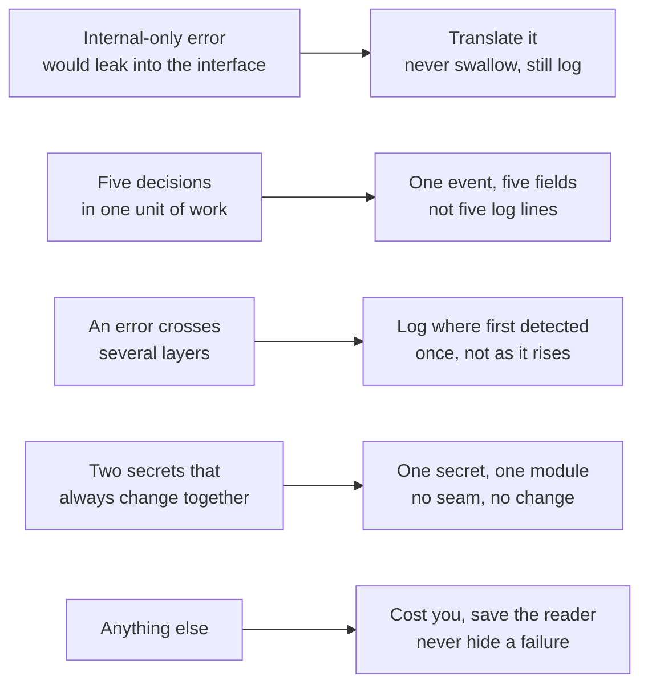

# Soft-Flow Dev Skills

Skills that make coding agents fluent in the way you work.

**Diffluent** reads a diff the way a careful colleague would: first explaining what changed, then judging whether it should merge. **Plainflow** covers the other half of the job — writing the code in the first place.

## Diffluent — reviewing

**`diffluent-explain`** — what changed, no opinion.

Turns a pull request into a before/after comparison written as business-rule pseudocode, so the logic is visible without the plumbing. It gives no verdict on purpose: you read it, form your own view, and only then ask for the review.

```
If order total >= 500, require manager approval   [OrderService.cs:42]
```

**`diffluent-review`** — should this merge?

Reviews through three lenses, each checked against a different source of truth:

| Lens | Question | Checked against |
|---|---|---|
| **Rules** | Does it do what was asked? | The work item and its acceptance criteria |
| **Contracts** | Does it use the technology correctly? | Official docs for the version this repo pins |
| **Structure** | Does it fit the codebase? | This repository's own conventions |

Every blocking concern is tagged with the lens that found it and a line saying how it was verified. Nothing is reported from memory.

## Design

- **Explain and review are separate.** Seeing a verdict before you have formed your own view anchors you to it.
- **Pseudocode for behaviour, literal code for everything else.** Pseudocode makes business rules visible by removing detail — which is exactly the detail a syntax or API bug hides in.
- **Precision over coverage.** One wrong concern costs more trust than a missed minor one, so unsure findings are dropped rather than hedged.
- **Short by design.** Hard caps on every list, and empty sections are omitted. A clean review is three lines.
- **Read-only, always.** Neither skill posts, approves, or pushes anything — even when running with write access on the PR itself.

## Plainflow — writing

**`plainflow`** — three rules, in priority order.

1. **Avoidable complexity is avoided.** No abstraction for a need that does not exist yet, no flag nobody sets, no reimplementation of what the repo already has. But error handling, boundary cases and validation are never "complexity" to be cut — they are the work.
2. **Unavoidable complexity is hidden.** When complexity is essential, this module carries it rather than every caller forever. The interface stays narrower than the implementation.
3. **Behaviour is explicit and traceable.** Outcomes are returned, not signalled through shared state; decisions are named; and structured logs make the behaviour visible in any environment, with no debugger and no reproduction.

Rules 1 and 3 pull against each other — a log line is code, and logging everything is avoidable complexity. The skill resolves it with one test: **log the rules, not the plumbing.** The lines you would write as business rules in a `diffluent-explain` comparison are exactly the lines worth logging.




The skill carries these as a flat list indexed by situation rather than by rule, because the decision arrives while you are writing code and thinking "this error is ugly", not "rule 2".

## Install

Both skills are plain [Agent Skills](https://agentskills.io), so they work in any compatible agent.

**As a plugin** (VS Code, Copilot CLI, Claude Code, Codex): add this repo as a marketplace, then install `soft-flow`. Install commands and settings differ per tool and change between versions — check your tool's current plugin documentation.

**By hand** (works anywhere): copy the two folders from `skills/` into whichever location your tool reads.

| Tool | Location |
|---|---|
| GitHub Copilot in VS Code, Copilot CLI | `.github/skills/` in your repo, or `~/.copilot/skills/` |
| Claude Code | `.claude/skills/` in your repo |
| Codex and other agents | `.agents/skills/` in your repo |

## Use

Run them in order:

```
Explain PR #482.          → diffluent-explain
Now review it.            → diffluent-review
```

Each accepts a PR URL, `owner/repo#number`, or a branch and its base.

## Requirements

A way to read the pull request: your tool's PR tools, the `gh` CLI, or a local clone. For the Contracts lens, documentation lookup or web fetch; without it, findings that depend on library behaviour are reported as unverified rather than asserted.

## Repo layout

```
plugin.json                       Agent Plugins 1.0 manifest
skills/
  diffluent-explain/SKILL.md
  diffluent-review/SKILL.md
.claude-plugin/                   Claude Code manifest + marketplace
.codex-plugin/                    Codex manifest
.github/plugin/marketplace.json   marketplace for VS Code and Copilot CLI
```

One `skills/` folder, several manifests — every tool reads the same skills.

## License

MIT
